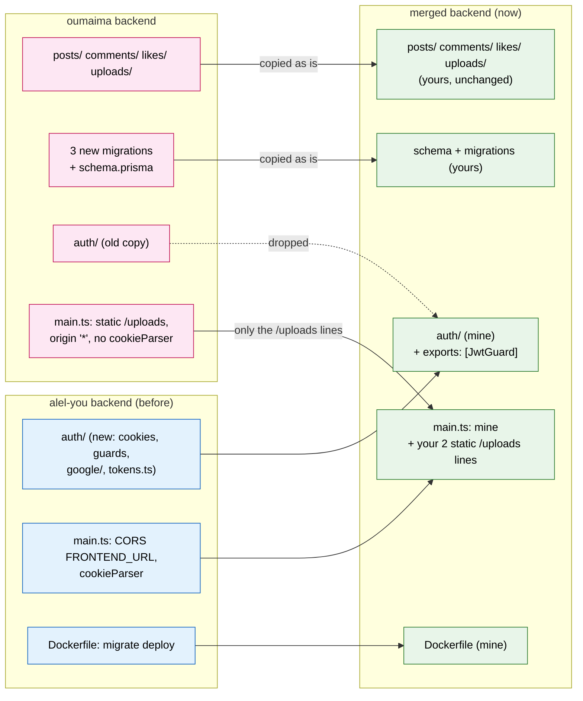
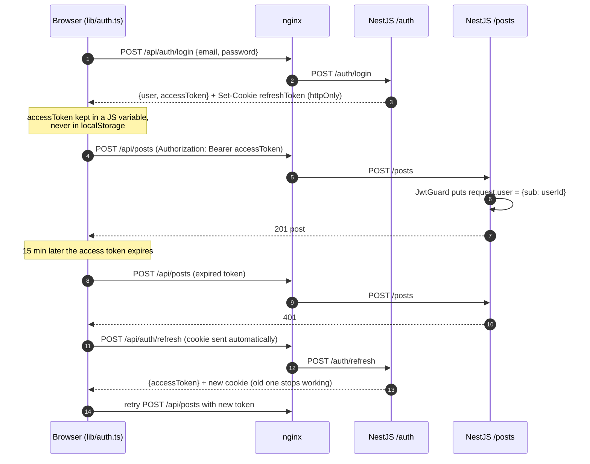
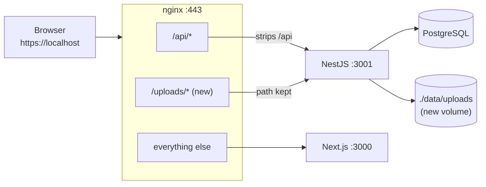
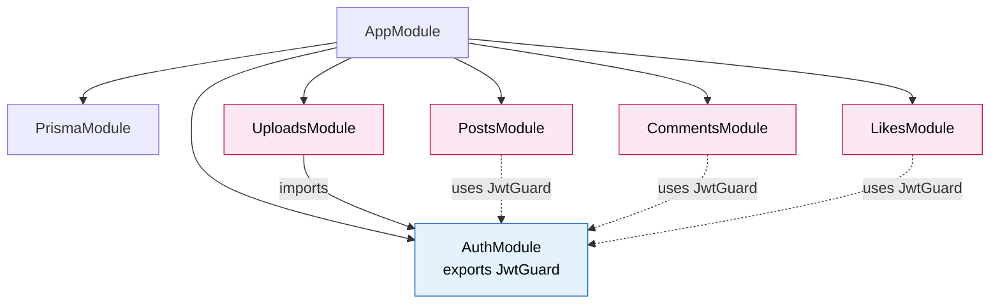
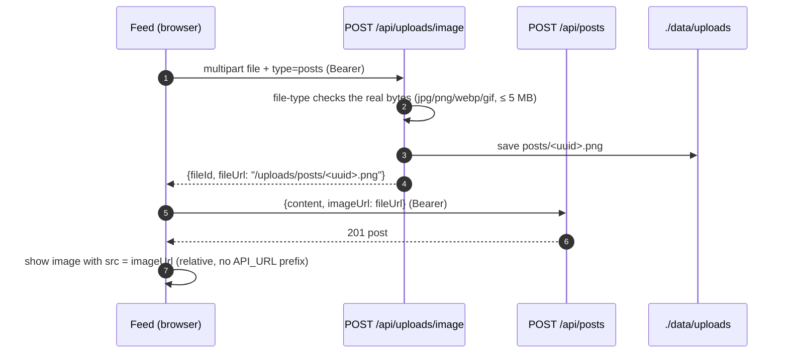
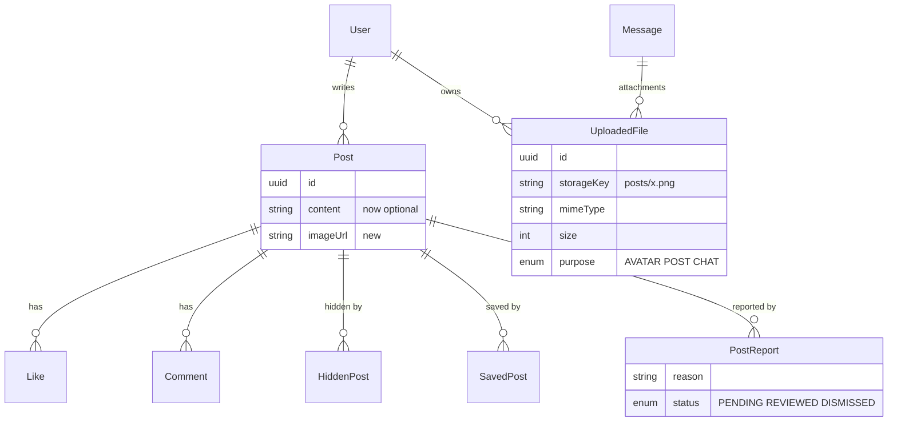
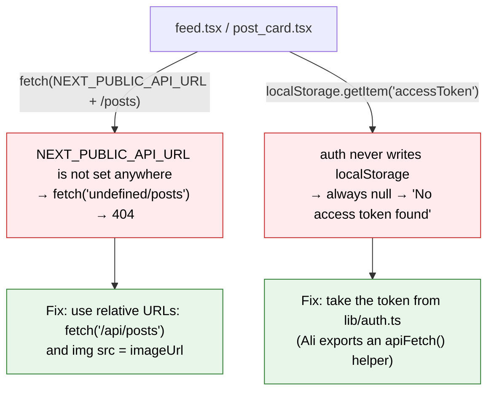

# Backend merge: `alel-you` + `oumaima`

**Short version:** your posts, comments, likes and uploads modules are now inside the
`alel-you` backend, running with the new auth. Everything starts in Docker Compose, the 3 new
migrations ran, and this flow was tested end to end through nginx:

> register → login → upload an image → load it at `https://localhost/uploads/...` → create a post → like it → comment on it

The backend works. **The feed page does not work yet** (see [Why the feed is broken](#4-why-the-feed-page-is-broken-right-now)).
The open work is split between us in [`TODO.md` → section 9](TODO.md).

---

## 1. What came from where

Your `backend/src/auth/` was an older copy of mine; the only thing you changed there was
`exports: [JwtGuard]`. So the merge was: **keep my auth, add your modules, and combine 6 shared files by hand.**



### Every file that changed

| File | Change | Why |
|---|---|---|
| `backend/src/posts/`, `comments/`, `likes/`, `uploads/` | **Copied from you, unchanged** | |
| `backend/prisma/migrations/2026110101…_add_post_features`<br/>`…20261107001653_add_uploaded_files`<br/>`…20261107005145_add_message_attachments` | Copied from you | New tables |
| `backend/prisma/schema.prisma` | Replaced with yours | Mine hadn't changed since our common commit `50101d5`, so yours only adds to it |
| `backend/src/app.module.ts` | Registers `PostsModule`, `UploadsModule`, `CommentsModule`, `LikesModule` | |
| `backend/src/auth/auth.module.ts` | Mine + `exports: [JwtGuard]` | Your `UploadsModule` imports `AuthModule` to use the guard |
| `backend/src/main.ts` | Mine + your 2 `app.use('/uploads/...', serveStatic(...))` lines | See below for what I did **not** take |
| `backend/package.json` | + `file-type`, + `@types/multer` | Kept `cookie-parser` |
| `backend/tsconfig.json` | `"types": ["node", "jest", "multer"]` | |
| `nginx/default.conf` | + `location /uploads/` → backend, + `client_max_body_size 5m` | Images 404'd (nginx sent `/uploads` to Next.js) and uploads over 1 MB got `413` |
| `docker-compose.yml` | backend volume `./data/uploads:/app/uploads` | Uploaded files were lost on every rebuild |

### What I did **not** take from your backend, and why

| Yours | Why it's not in the merge |
|---|---|
| `origin: '*'` in CORS | Browsers reject `*` together with `credentials: true`, so the refresh cookie would stop working. Kept `origin: FRONTEND_URL` |
| `// app.use(cookieParser())` (commented out) | My refresh token is a cookie. Without the cookie parser, `/auth/refresh` and `/auth/logout` break |
| `auth/google.strategy.ts`, `google-oauth.config.ts` | Replaced by `auth/google/` (state check, verified-email check) |
| `auth/dto/refresh-token.dto.ts` | The refresh token is no longer sent in the body; it's a cookie |
| `CMD ["npm", "run", "start:prod"]` in the Dockerfile | Mine runs `npx prisma migrate deploy` first. That's how your tables got created automatically |
| Frontend `app/auth/google/callback/page.tsx` | It put tokens in `localStorage`. The backend now sets a cookie and redirects straight to `/feed` |

---

## 2. What changed in auth (what you need to know to use it)

Your old copy of auth worked like this: login returned **both** tokens in JSON, and the frontend kept them in `localStorage`.
That is gone. The rule now:

- **Access token** (15 min): returned by `/auth/login` and `/auth/refresh`. The frontend keeps it **in memory only** (`frontend/lib/auth.ts`). Send it as `Authorization: Bearer <token>`. **Nothing is ever written to `localStorage`.**
- **Refresh token** (7 days): an `httpOnly` cookie limited to `/api/auth`. JavaScript can't read it; the browser sends it automatically.
- After a page reload the access token is gone. `getMe()` calls `/auth/refresh` (the cookie) and gets a new one.



### Auth routes

| Route | Guard | Notes |
|---|---|---|
| `POST /auth/register` | none | `interests` needs **at least 1** item. Duplicate email or username → `409` |
| `POST /auth/login` | none | Wrong credentials → `401` (was `409`) |
| `POST /auth/refresh` | cookie | Rotates the cookie; an old refresh token no longer works |
| `POST /auth/logout` | cookie | Clears the cookie |
| `GET /auth/google` → `/auth/google/callback` | Google | On success: sets the cookie and redirects to **`/feed`** |
| `GET /auth/me` | `JwtGuard` | The current user (safe fields only) |
| `GET /auth/list` | `JwtGuard` + `AdminGuard` | |
| `GET`, `PATCH`, `DELETE /auth/:id` | `JwtGuard` + `OwnerOrAdminGuard` | `PATCH` only accepts `username`, `bio`, `avatarUrl`, `interests` |
| `PATCH /auth/:id/password` | `JwtGuard` + `OwnerOrAdminGuard` | |

**Good news for your code:** `JwtGuard` still sets `request.user.sub`, so your four controllers work without any change.
Details: [`backend/src/auth/README.md`](backend/src/auth/README.md).

---

## 3. How it fits together now

### Request routing



- `https://localhost/api/posts` → backend `/posts`
- `https://localhost/uploads/posts/<id>.png` → backend serves the file from `/app/uploads/posts/`
- Only `uploads/posts/` and `uploads/avatars/` are public. Chat files go to `uploads/private/chat/` and are **not** served.

### Backend modules



### Posting with an image (tested)



### New tables (from your migrations)



`HiddenPost`, `SavedPost` and `PostReport` exist in the database but **have no endpoints yet**.

---

## 4. Why the feed page is broken right now

The backend works (tested with `curl`), but the feed UI can't reach it, for two reasons:



Relative URLs (`/api/...`) work in both setups: nginx routes them in Docker, and a Next.js rewrite will handle `npm run dev` (on Ali's list).

---

## 5. Is your backend fully functional?

**Mostly. The main features work, but there are bugs and missing pieces.** All of them are listed with an owner in [`TODO.md` → section 9](TODO.md).

| Area | Status |
|---|---|
| Create / list / edit / delete post | ✅ works |
| Like / unlike / like count | ✅ works |
| List / add comments | ✅ works |
| Image upload (real type check, 5 MB) | ✅ works |
| Invalid id in the URL (`/posts/abc/comments`) | ❌ **500** instead of 400 (verified) |
| Comment body | ⚠️ no DTO: no max length, a non-string `content` crashes with 500 |
| `imageUrl` on a post | ⚠️ accepts any string, even another user's file or an external URL |
| Deleting a post | ⚠️ the image file and its `UploadedFile` row stay forever |
| `GET /posts` | ⚠️ no pagination, and no `isLiked`: the feed makes 1 extra request per post |
| Edit / delete a comment | ❌ missing |
| Hide / save / report a post | ❌ tables only, no endpoints |
| Chat attachments | ⚠️ upload works, but there is no way to download them (and no chat module yet) |
| Avatar upload | ⚠️ saves the file but doesn't update `user.avatarUrl`; the frontend must call `PATCH /auth/:id` |
| Admin moderation | ❌ an admin can't delete someone else's post or comment |
| Tests | ❌ none |

---

## 6. Running it

```bash
docker compose up -d --build          # always --build after changing code, or you run the old image
docker compose logs -f backend        # migrations + mapped routes appear here
```

- After editing `nginx/default.conf`: `docker compose up -d --force-recreate nginx`. A plain reload keeps the **old** file, because Docker mounts the file itself, not the folder.
- Swagger with every route: `http://localhost:3001/docs`
- Uploaded files on the host: `./data/uploads/` (owned by root, in `.gitignore`)

## 7. How we continue without a second merge

1. Ali commits the merge on `alel-you`.
2. Oumaima starts from that branch (`git fetch && git checkout -b oumaima-feed origin/alel-you`) instead of her old `oumaima` branch, so her auth copy doesn't come back.
3. From now on: **Ali owns `backend/src/auth/` and `frontend/lib/auth.ts`; Oumaima owns `posts/`, `comments/`, `likes/`, `uploads/` and `components/feed/`.** Changes to the other person's folders go through a PR.
